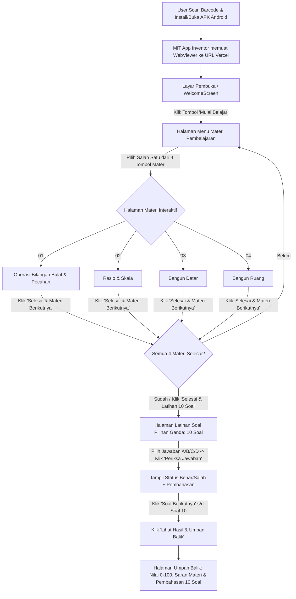

# Dokumentasi Logika Aplikasi & Coding Blok — Media Pembelajaran Matematika Kelas 6 SD

Dokumentasi ini disusun untuk menjelaskan **alur penggunaan aplikasi (dari membuka APK hingga menyelesaikan latihan soal beserta umpan balik)** serta **blok kode (*coding block*) logika setiap tombol** pada aplikasi web pembelajaran **Matematika Dasar Kelas 6 SD**.

---

## 1. Tujuan, Fungsi, dan Fitur Aplikasi

- **Tujuan**: Menyediakan media pembelajaran interaktif Matematika Dasar Kelas 6 SD yang ringan, responsif, dan dapat diakses langsung melalui aplikasi Android (MIT App Inventor `WebViewer`) hasil pemindaian barcode maupun browser desktop.
- **Fungsi Utama**:
  1. Menyajikan 4 topik inti Matematika Kelas 6 SD dengan simulasi visual interaktif.
  2. Menyimpan progres belajar siswa secara otomatis di perangkat (`localStorage`).
  3. Mengarahkan siswa untuk mengerjakan evaluasi berupa **10 soal pilihan ganda** setelah mempelajari materi.
  4. Memberikan **umpan balik (*feedback*)** otomatis berupa nilai akhir, analisis ketuntasan per topik, saran materi yang perlu diulang, dan pembahasan lengkap.

---

## 2. Alur Penggunaan Aplikasi (User Flow: Buka APK → Selesai Latihan)

Berikut adalah alur lengkap pengguna sejak membuka aplikasi Android (`.apk`) hingga memperoleh umpan balik akhir:



### Penjelasan Alur Langkah demi Langkah
1. **Membuka APK Android (MIT App Inventor)**:
   Pengguna membuka aplikasi `.apk` yang diunduh setelah memindai barcode. Komponen `WebViewer` pada `Screen1` otomatis memuat halaman web pembelajaran yang di-hosting di Vercel.
2. **Layar Pembuka (`WelcomeScreen`)**:
   Pengguna melihat judul **Matematika Dasar Kelas 6 SD**, ringkasan cakupan materi, dan menekan tombol **"Mulai Belajar"** (atau **"Lanjutkan Belajar"** jika sebelumnya sudah ada progres tersimpan).
3. **Menu Materi Pembelajaran (`MenuScreen`)**:
   Pengguna masuk ke daftar **4 materi utama** beserta indikator kemajuan (`0 / 4 Selesai`). Pengguna dapat mengetuk salah satu tombol materi secara berurutan.
4. **Eksplorasi Materi Interaktif (Materi 01 – 04)**:
   - Di setiap halaman materi, siswa menggeser *slider* atau menekan tombol pilihan (misalnya garis bilangan, pecahan, skala peta, ukuran bangun datar/ruang) untuk melihat perubahan visual dan langkah rumus secara langsung.
   - Setelah memahami materi, siswa menekan tombol **"Selesai & Materi Berikutnya"** di bagian bawah halaman. Sistem mencatat materi tersebut sebagai *Sudah Dipelajari*.
5. **Pengarahan ke Latihan Soal (10 Soal Pilihan Ganda)**:
   Setelah materi ke-4 diselesaikan, tombol pengarah berubah menjadi **"Selesai & Latihan 10 Soal"** (dan pada Menu muncul sorotan siap mengerjakan latihan). Siswa masuk ke halaman evaluasi berisi **10 soal pilihan ganda**.
6. **Mengerjakan Soal & Melihat Pembahasan**:
   Pada setiap soal, siswa memilih opsi **A, B, C, atau D**, menekan **"Periksa Jawaban"** untuk langsung mengetahui benar/salah beserta pembahasannya, lalu menekan **"Soal Berikutnya"**.
7. **Menerima Umpan Balik Akhir (*Feedback*)**:
   Setelah soal ke-10 selesai, tombol **"Lihat Hasil & Umpan Balik"** menampilkan:
   - **Nilai Akhir** (`0 – 100`) dan jumlah jawaban benar dari 10 soal.
   - **Umpan Balik Kategori Nilai** (Sangat Baik $\ge 90$, Bagus $70\text{--}89$, Perlu Latihan Lagi $< 70$).
   - **Rincian Ketuntasan per Topik** beserta tombol pintasan untuk mengulang materi yang masih salah.
   - **Pembahasan Lengkap 10 Soal** serta tombol **"Ulangi Latihan"** atau **"Menu Materi"**.

---

## 3. Coding Blok Logika APK Wrapper (MIT App Inventor)

Pada sisi aplikasi Android (MIT App Inventor), blok logika yang digunakan untuk memuat web pembelajaran dan menangani tombol *Back* HP adalah sebagai berikut:

```text
when Screen1.Initialize
do
    call WebViewer1.GoToUrl
         url: "https://alamat-vercel-anda.vercel.app"

when Screen1.BackPressed
do
    if call WebViewer1.CanGoBack
    then
        call WebViewer1.GoBack
    else
        close application
```

---

## 4. Coding Blok Logika Setiap Tombol Web Pembelajaran

Berikut adalah potongan blok kode aktual untuk setiap tombol dan alur logika di dalam aplikasi web (`src/`).

### A. Logika Navigasi Halaman & Tombol Back (`src/App.tsx`)

Mengatur perpindahan antar halaman (`welcome`, `menu`, `bilangan`, `rasio`, `bangun-datar`, `bangun-ruang`, `latihan`) serta menyinkronkan URL hash agar tombol *Back* di Android WebViewer berjalan normal.

```tsx
const VALID_ROUTES: PageRoute[] = [
  'welcome',
  'menu',
  'bilangan',
  'rasio',
  'bangun-datar',
  'bangun-ruang',
  'latihan',
];

function readRouteFromHash(): PageRoute {
  if (typeof window === 'undefined') return 'welcome';
  const raw = window.location.hash.replace('#', '').toLowerCase() as PageRoute;
  return VALID_ROUTES.includes(raw) ? raw : 'welcome';
}

const navigate = useCallback((nextRoute: PageRoute) => {
  setRoute(nextRoute);
  if (typeof window !== 'undefined') {
    const targetHash = `#${nextRoute}`;
    if (window.location.hash !== targetHash) {
      window.history.pushState(null, '', targetHash);
    }
    window.scrollTo({ top: 0, behavior: 'smooth' });
  }
}, []);
```

**Logika Tombol Navigasi Bawah (Mobile WebViewer):**
```tsx
// Tombol Awal
<button type="button" onClick={() => navigate('welcome')}>
  Awal
</button>

// Tombol Menu Materi
<button type="button" onClick={() => navigate('menu')}>
  Menu Materi
</button>

// Tombol Latihan Soal (10)
<button type="button" onClick={() => navigate('latihan')}>
  Latihan (10)
</button>
```

---

### B. Logika Penyimpanan Progres Belajar (`src/hooks/useLearningProgress.ts`)

Menyimpan daftar materi yang sudah diselesaikan dan nilai kuis terbaik ke `localStorage` perangkat siswa.

```tsx
const markTopicCompleted = useCallback((topicId: TopicId) => {
  setProgress((prev) => {
    if (prev.completedTopics.includes(topicId)) return prev;
    return {
      ...prev,
      completedTopics: [...prev.completedTopics, topicId],
    };
  });
}, []);

const recordQuizResult = useCallback((percentage: number) => {
  setProgress((prev) => ({
    ...prev,
    lastQuizScore: percentage,
    bestQuizScore:
      typeof prev.bestQuizScore === 'number'
        ? Math.max(prev.bestQuizScore, percentage)
        : percentage,
  }));
}, []);

const resetProgress = useCallback(() => {
  setProgress(DEFAULT_PROGRESS);
}, []);
```

---

### C. Tombol "Mulai Belajar" pada Layar Pembuka (`src/components/WelcomeScreen.tsx`)

Mengarahkan pengguna dari layar awal ke halaman Menu Materi Pembelajaran.

```tsx
<button
  type="button"
  onClick={onStart} // Memanggil navigate('menu')
>
  <Play className="w-5 h-5 fill-current" aria-hidden="true" />
  <span>{completedCount > 0 ? 'Lanjutkan Belajar' : 'Mulai Belajar'}</span>
</button>
```

---

### D. Logika 4 Tombol Materi, Tombol Reset, & Tombol Latihan di Menu (`src/components/MenuScreen.tsx`)

Menampilkan 4 tombol materi dari array `TOPICS`, mengecek apakah materi sudah selesai (`isDone`), tombol reset progres, serta tombol menuju halaman latihan soal.

```tsx
// 1. Tombol Ulangi Progres (muncul jika sudah ada materi yang selesai)
{completedCount > 0 && (
  <button type="button" onClick={onResetProgress}>
    Ulangi Progres
  </button>
)}

// 2. Empat Tombol Materi Pembelajaran
{TOPICS.map((topic) => {
  const isDone = progress.completedTopics.includes(topic.id as TopicId);
  return (
    <button
      key={topic.id}
      type="button"
      onClick={() => onNavigate(topic.id)} // Membuka 'bilangan' | 'rasio' | 'bangun-datar' | 'bangun-ruang'
    >
      <span>{topic.numberLabel}</span>
      <h2>{topic.title}</h2>
      <span>{isDone ? 'Sudah Dipelajari' : 'Ketuk untuk mempelajari'}</span>
    </button>
  );
})}

// 3. Tombol Latihan Soal Pilihan Ganda (10 Soal)
<button type="button" onClick={() => onNavigate('latihan')}>
  {allCompleted ? 'Mulai Latihan 10 Soal' : 'Buka Latihan Soal'}
</button>
```

---

### E. Logika Tombol Interaktif pada Setiap Halaman Materi

#### 1. Materi 01 — Operasi Bilangan Bulat & Pecahan (`src/components/TopicBilangan.tsx`)
```tsx
// Tombol Ganti Sub-materi (Bilangan Bulat / Pecahan)
<button type="button" onClick={() => setSubTab('bulat')}>Bilangan Bulat</button>
<button type="button" onClick={() => setSubTab('pecahan')}>Pecahan</button>

// Tombol Operasi Tambah (+) dan Kurang (-) pada Garis Bilangan
<button type="button" onClick={() => setOp('+')}>Tambah (+)</button>
<button type="button" onClick={() => setOp('-')}>Kurang (-)</button>

// Logika Perhitungan Hasil Garis Bilangan & Penyederhanaan Pecahan
const intResult = op === '+' ? startNum + secondNum : startNum - secondNum;
const commonDen = lcm(denA, denB);
const sumNum = numA * (commonDen / denA) + numB * (commonDen / denB);
const divisor = gcd(sumNum, commonDen);
const simpNum = sumNum / divisor;
const simpDen = commonDen / divisor;
```

#### 2. Materi 02 — Rasio & Skala (`src/components/TopicRasio.tsx`)
```tsx
// Tombol Ganti Sub-materi (Rasio Sederhana / Skala Peta)
<button type="button" onClick={() => setSubTab('rasio')}>Rasio Sederhana</button>
<button type="button" onClick={() => setSubTab('skala')}>Skala Peta</button>

// Tombol Pilihan Skala Peta (1 : 100.000 s.d. 1 : 1.000.000)
{[100000, 250000, 400000, 1000000].map((s) => (
  <button key={s} type="button" onClick={() => setScaleDenominator(s)}>
    1 : {s.toLocaleString('id-ID')}
  </button>
))}

// Logika Perhitungan Rasio & Jarak Sebenarnya
const ratioGcd = gcd(countA, countB);
const simpA = countA / ratioGcd;
const simpB = countB / ratioGcd;
const realDistKm = (mapDistCm * scaleDenominator) / 100000;
```

#### 3. Materi 03 — Bangun Datar (`src/components/TopicBangunDatar.tsx`)
```tsx
// Tombol Pilihan Bentuk Bangun Datar
onClick={() => {
  setShape(item.id); // 'persegi' | 'persegi-panjang' | 'segitiga' | 'lingkaran'
  if (item.id === 'lingkaran') setValA(14);
  else setValA(12);
}}

// Tombol Preset Jari-Jari Lingkaran (kelipatan 7 agar pi = 22/7)
{[7, 10, 14, 21].map((r) => (
  <button key={r} type="button" onClick={() => setValA(r)}>
    r = {r} cm
  </button>
))}
```

#### 4. Materi 04 — Bangun Ruang (`src/components/TopicBangunRuang.tsx`)
```tsx
// Tombol Pilihan Bentuk 3D (Kubus, Balok, Tabung)
onClick={() => {
  setShape3d(item.id); // 'kubus' | 'balok' | 'tabung'
  if (item.id === 'tabung') {
    setP(7);
    setT(10);
  } else if (item.id === 'kubus') {
    setP(8);
  } else {
    setP(10);
    setL(6);
    setT(8);
  }
}}
```

---

### F. Logika Tombol Penyelesaian Materi & Pengarahan ke Latihan (`src/components/TopicFooterAction.tsx`)

Saat siswa menekan tombol selesai di bagian bawah halaman materi, fungsi ini menandai materi selesai dan otomatis menentukan apakah siswa diarahkan ke materi berikutnya atau langsung ke halaman **Latihan 10 Soal**.

```tsx
const handleCompleteAndContinue = () => {
  onCompleteTopic(currentTopicId);
  if (willAllBeDone || !nextTopic) {
    onNavigate('latihan');
  } else {
    onNavigate(nextTopic.id);
  }
};

// Tombol Kembali ke Menu
<button type="button" onClick={() => onNavigate('menu')}>
  Menu
</button>

// Tombol Selesai & Lanjut / Latihan 10 Soal
<button type="button" onClick={handleCompleteAndContinue}>
  {willAllBeDone || !nextTopic ? 'Selesai & Latihan 10 Soal' : 'Selesai & Materi Berikutnya'}
</button>
```

---

### G. Logika Tombol Latihan 10 Soal & Umpan Balik Akhir (`src/components/LatihanQuiz.tsx`)

Mengelola pemilihan opsi A/B/C/D, pengecekan jawaban, perpindahan ke soal berikutnya, penghitungan skor akhir, serta pembentukan umpan balik dan rekomendasi materi.

```tsx
// 1. Memilih opsi jawaban (A, B, C, atau D)
const handleSelectOption = (idx: number) => {
  if (isChecked) return;
  setSelectedOption(idx);
};

// 2. Tombol "Periksa Jawaban"
const handleCheck = () => {
  if (selectedOption === null) return;
  setAnswers((prev) => ({
    ...prev,
    [currentQuestion.id]: selectedOption,
  }));
  setIsChecked(true);
};

// 3. Tombol "Soal Berikutnya" atau "Lihat Hasil & Umpan Balik"
const handleNext = () => {
  if (currentIndex + 1 < totalQuestions) {
    setCurrentIndex((prev) => prev + 1);
    setSelectedOption(null);
    setIsChecked(false);
  } else {
    const finalAnswers = {
      ...answers,
      [currentQuestion.id]: selectedOption ?? -1,
    };
    const correctCount = QUIZ_QUESTIONS.reduce(
      (sum, q) => sum + (finalAnswers[q.id] === q.correctIndex ? 1 : 0),
      0
    );
    const score = Math.round((correctCount / totalQuestions) * 100);
    onCompleteQuiz(score);
    setIsFinished(true);
  }
};

// 4. Tombol "Ulangi Latihan" pada halaman Umpan Balik
const handleRestart = () => {
  setCurrentIndex(0);
  setSelectedOption(null);
  setAnswers({});
  setIsChecked(false);
  setIsFinished(false);
};
```

**Logika Penentuan Umpan Balik (*Feedback*) Akhir:**
```tsx
// Menghitung ketuntasan per topik
const topicBreakdown = TOPICS.map((topic) => {
  const qs = QUIZ_QUESTIONS.filter((q) => q.topicId === topic.id);
  const ok = qs.filter((q) => answers[q.id] === q.correctIndex).length;
  return {
    id: topic.id as TopicId,
    title: topic.title,
    correct: ok,
    total: qs.length,
  };
});

const weakTopics = topicBreakdown.filter((tb) => tb.correct < tb.total);

// Menentukan pesan umpan balik berdasarkan nilai akhir (0 - 100)
if (score >= 90) {
  feedbackTitle = 'Luar Biasa! Pemahaman Matematika Kelas 6 Kamu Sangat Baik';
} else if (score >= 70) {
  feedbackTitle = 'Bagus! Pemahaman Konsep Dasar Sudah Kuat';
} else {
  feedbackTitle = 'Tetap Semangat! Mari Ulangi Materi yang Masih Perlu Dikuatkan';
}
```
